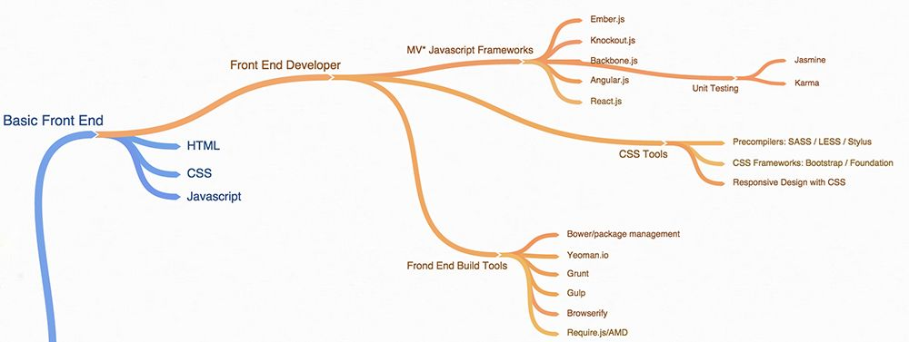
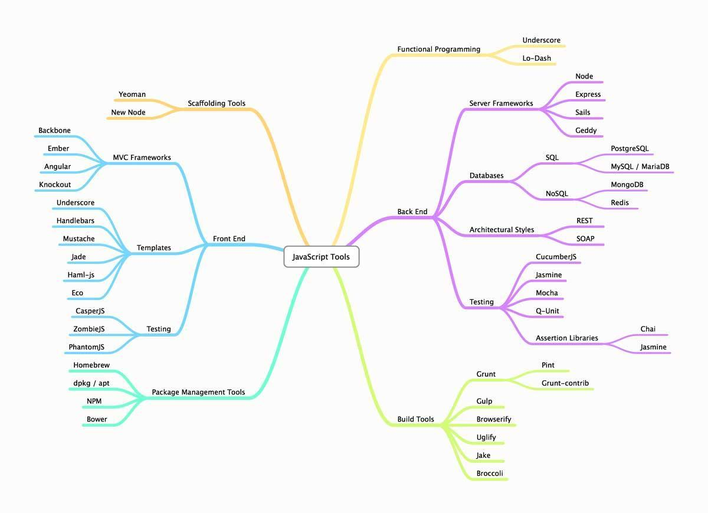
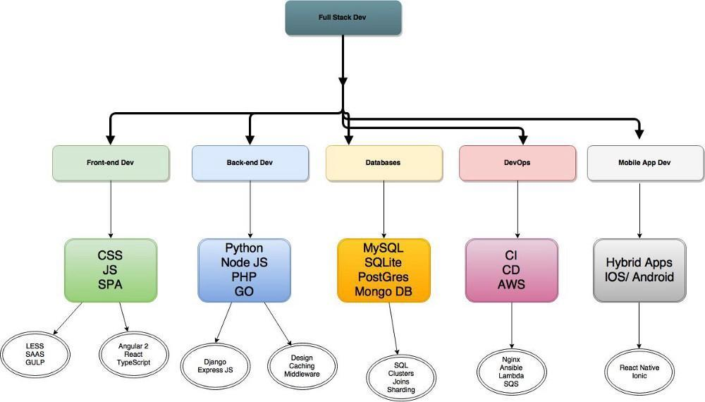
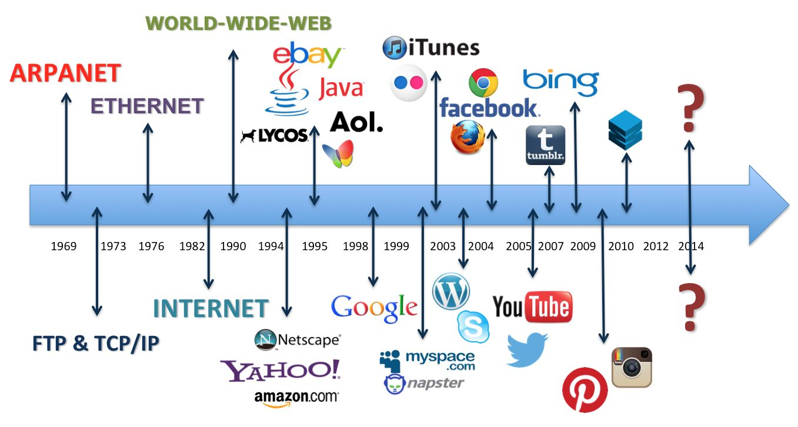
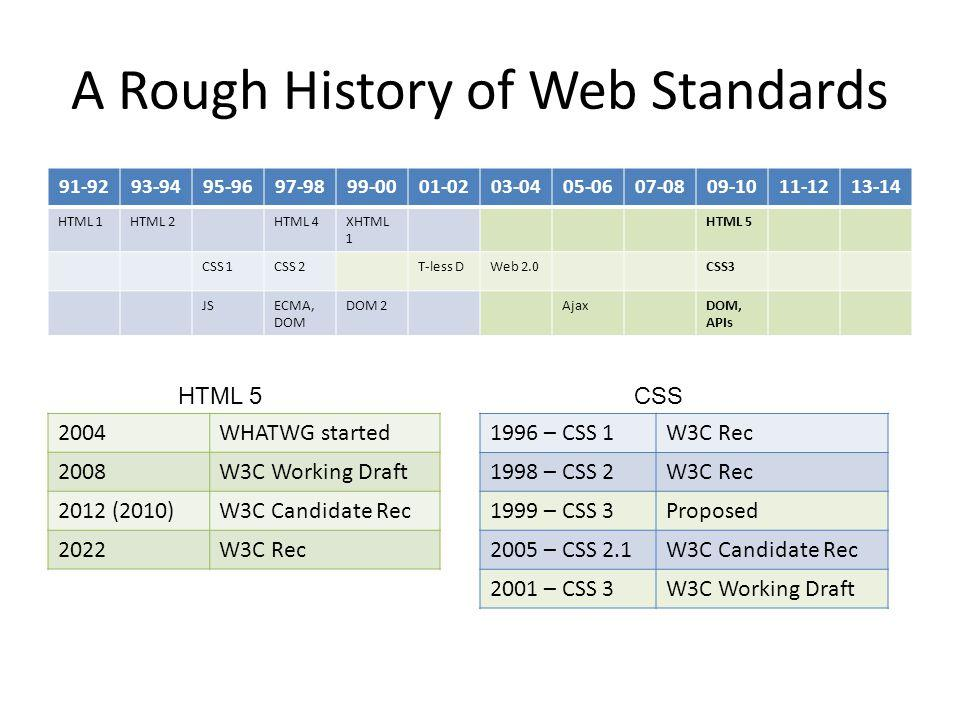
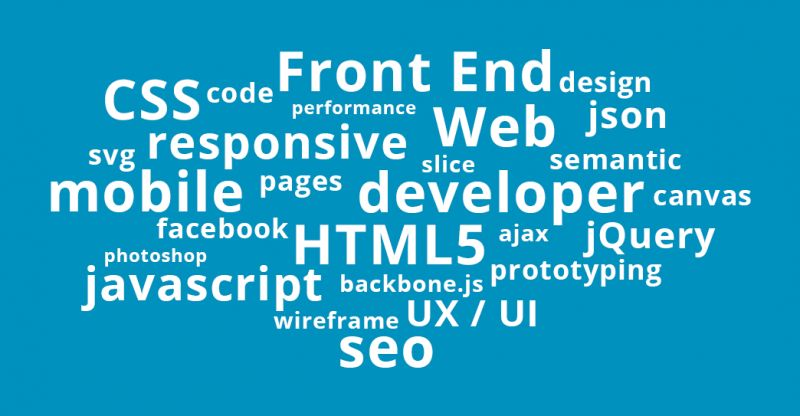

### Introduction

* Getting to know each other
* Job market requirements
* About the internet
* Where to start?
* Terminology
* Setting up the work environment

---

## Getting to know each other

### Your instructor — Edmunds Pūce

* **Homepage:** [epuce.info](http://epuce.info/)
* **Education:** Professional bachelor's in e-business and logistics management systems.
* **Programming experience:** front-end & full-stack development (Tieto, Dyninno, Dynatech, freelancing).
* **Occupation:** full-stack web developer @ Scoro.
* **Hobbies:** everything in and around sports.
* **Find me online:** [Instagram](https://www.instagram.com/edm.puce/) · [Facebook](https://www.facebook.com/edm.puce) · [LinkedIn](https://www.linkedin.com/in/edmunds-p%C5%ABce-a9247a161/)

### About the course

* An intensive and concentrated course.
* Receive a certificate.
* Lectures are recorded and archived.
* Retake the course for free within 1 year.
* Attend free guest lectures.
* 20% theory and 80% practice.

### What will be covered?

* Docker & Git — local environment and version control
* HTML
* CSS — Flexbox, Grid, media queries, frameworks (Bootstrap)
* JavaScript (modern ES6+, plus jQuery)
* TypeScript
* Vue — with an overview of React & Angular
* PHP — CRUD, MVC, unit tests, sessions & security
* SQL (and a look at NoSQL / MongoDB)
* REST API design
* Deployment & hosting
* Final project

Extra topics: GraphQL, Vue Material (Vuetify) & form handling, state management (Pinia), modern project setup.

By the end of the course you will be able to build a working web application from front to back.

---

## Job market requirements

### Front-end roadmap (2014)

### JavaScript tools (2016)

### Full-stack developer (2018)

### Today

* The tooling keeps growing, but the core stays the same — learn the fundamentals first, then layer tools on top as you need them.
* For an up-to-date, interactive view of what employers expect, see [roadmap.sh](https://roadmap.sh/) (frontend, backend, full-stack and more).

### Reality

* The unchanging web components:
    * HTML
    * CSS
    * JavaScript
* Everything else (frameworks, build tools, TypeScript, package managers…) sits on top of these three.

---

## About the internet

### History (part 1)

* **1958** — ARPA (Advanced Research Projects Agency) is founded.
* **1962** — the first primitive computer network, ARPAnet, is created.
* **1965** — the first routers, known as IMP (interface message processors).
* **1981** — the first network connecting remote stations, NFSNET (National Science Foundation Network).

### History (part 2)

* **1989** — HTTP (hypertext transfer protocol), still in use today.
* **1993** — Mosaic web browser, one of the first with a graphical interface.
* **1995** — the existing internet network is opened up for public access and the big boom can begin.

### How does it work?

* In essence, the internet is a network that can move data from one point to another.
* Each connection point has its own unique public IP address.
* In browsers these IPs are hidden behind domain names.
* The browser recognizes the transferred data and can render it accordingly:
    * What is rendered can differ between browsers.

📺 [How the Internet Works in 5 Minutes (2009)](https://www.youtube.com/watch?v=7_LPdttKXPc)

### Timeline of the web

### A rough history of web standards

* Today HTML is a "living standard" maintained by the WHATWG — there are no more numbered versions after HTML5, the spec is updated continuously.

---

## Where to start?

### Why are you here?

* Previous experience related to the topic?
* What do you expect from the course?
* Any other questions?

### Plan → Analyze → Understand → Develop (define the goal)

* Goal:
    * Project
    * Knowledge
    * Necessity
* Look at the available technologies:
    * Programming languages and their frameworks
    * Databases
    * Design needs / options
    * Version control system (needed / not needed)

### Plan → Analyze → Understand → Develop (do the research)

* Get familiar with the documentation.
* Watch videos for beginners.
* Consult a specialist.

### Set up your work environment (hardware)

* Physical environment:
    * Monitor (type, refresh rate, resolution, position)
    * Chair, desk
    * Input methods (mouse, keyboard, touch input)
* Operating system
* Code editor
* Terminal
* Browser
* Server (for development / production / testing) — in this course a Docker container

### Set up your work environment (software)

* Install the necessary software:
    * Those mentioned above
    * Docker (our local development environment)
    * Compilers
    * Package managers
    * Programming languages
    * Design software
    * Others (API simulators, browser plugins, etc.)

### That's it?

* However insignificant these kinds of decisions may seem at this stage, situations often arise where switching from one choice to another is almost impossible.
* Don't get ahead of yourself — start with the basics and only then tackle more complex situations.
* Don't forget — don't lose your enthusiasm and be patient!
* Don't be afraid to ask — Google, colleagues, me!

---

## Terminology

### Understand it? → Use it!

### Browser-related (part 1)

* **Front-end** — what's visible in the browser (HTML, CSS, JS).
* **HTML** — Hypertext Markup Language (the 'body' visible in the browser).
    * **DOM** — Document Object Model (the 'skeleton').
    * **Tag** — HTML blocks (the 'skeleton parts').
    * **Attributes** — properties of HTML blocks (tags).
* **CSS** — Cascading Style Sheets (the appearance visible in the browser).
    * **Selectors** — choosing HTML tags by conditions.
    * **{property: value}** — a property with its corresponding value.
    * **Breakpoints** — the browser size at which conditions change.
    * **Media queries** — conditions against screen size.

### Browser-related (part 2)

* **JS** — JavaScript (the interactive part of the page; the page reacting to user actions).
    * **Selectors** — choosing HTML tags by conditions.
    * **Life cycle** — a JavaScript object's usage cycle from when it appears until it is no longer used.
    * **Variables** — their types, usage, and properties differ.
* **TypeScript** — a typed superset of JavaScript that compiles down to plain JavaScript (used with Angular).
* **SPA** — Single Page Application; the page updates in place instead of reloading (Angular, React, Vue).
* **Compilers** — convert programming languages into a format understood by the intended target (scss → css, es6 → javascript).

### Server-side related (part 1)

* **Back-end** — operations happening on the server side.
* **SQL** — Structured Query Language (the most commonly used database management language).
* **API** — application programming interface (the way the browser communicates with the server).
* **REST** — a common set of conventions for structuring web APIs over HTTP.
* **Git** — a version (content) management system.

### Server-side related (part 2)

* **Builds** — generating the system.
* **Frameworks** — coding-language frameworks that ease system development and set up its "skeleton".
* **Interpreters** — convert programming languages to conform to older standards (e.g. in old browser versions).

---

## Setting up the work environment

### Code editor

* Visual Studio Code (PHPStorm, SublimeText, Atom, Notepad++) — [download](https://code.visualstudio.com/download)
* How to choose:
    * Paid / free
    * Built-in features (terminal, version control, plugins, compilers)
    * The computer's ability to handle the editor's background operations
    * Personal reasons (used before, visually pleasing…)

### Terminal

* Every operating system has a built-in terminal.
* Most code editors also offer the option to use a terminal.
* More advanced terminals give more convenient system management:
    * copy / paste
    * shortcuts
    * using multiple screens / sessions in one place
* Windows — Windows Terminal
* Linux — GNOME Terminal / Yakuake
* MacOS — iTerm2 / Warp

### Containerized environment (Docker)

* This course uses Docker for a consistent local development environment — see [W01L02 - Docker setup & Git](W01L02%20-%20Docker%20setup%20%26%20Git.md).
* [Docker Desktop](https://www.docker.com/products/docker-desktop) (on Windows it runs on the WSL2 backend).
* Bring the environment up with `docker compose up --build`.

### Version control system

* Git + GitHub — [git-scm.com/downloads](https://git-scm.com/downloads)
* Create a profile at [github.com](https://github.com/)
* Set up the global settings and an SSH key for easier access.

### Package managers (during the course)

* Node.js + npm — [nodejs.org](https://nodejs.org/en/download/)
* Others:
    * Composer (PHP) — [getcomposer.org](https://getcomposer.org/doc/00-intro.md)
    * Ruby gems — [rubygems.org](https://rubygems.org/pages/download)

### Frameworks (during the course)

* PHP
* Vue (v3)
* Overview of Angular, React, Node.js, GraphQL and MongoDB

---

## Resources

If you're stuck — ask!

* [developer.mozilla.org](https://developer.mozilla.org/en-US/) — the most precise
* [w3schools.com](https://www.w3schools.com/) — well structured
* [stackoverflow.com](https://stackoverflow.com/) — dev community
* [roadmap.sh](https://roadmap.sh/) — up-to-date developer roadmaps
