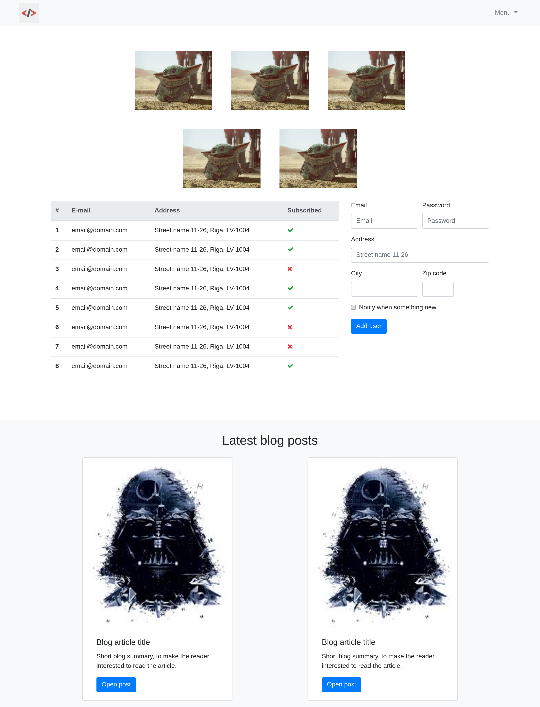

# 🧩 CSS frameworks

## Bootstrap

[link](https://getbootstrap.com/) (Bootstrap 5, no jQuery dependency anymore)

* Layout (Grid - not the same as css display: grid)
* Content (Native styling, images, code, tables, figures)
* Components (buttons, nav bar, spinner, card, etc.)
* Utilities (display, float, shadows, sizing, etc. )

## Font-awesome (icons)

[link](https://fontawesome.com/)

- No need to look for icons, just add the icon class to an element
- Can stye as any other font (size, color, etc.)

``` html
<head>
    <link rel="stylesheet" href="https://cdnjs.cloudflare.com/ajax/libs/font-awesome/6.7.2/css/all.min.css">
</head>

<style>
    .container {
        display: flex;
        width: 300px;
        justify-content: space-between;
        font-size: 50px; 
    }

    i {
        width: 50px;
        height: 50px;
        font-size: 50px;
        display:inline-block;
    }

    i:first-child {
        color: red;
    }

    i:nth-child(2):hover {
        opacity: 0.5;
    }

    i:nth-child(3) {
        font-weight: 700;
    }
</style>

<body>    
    <i class="fa-solid fa-camera"></i>
    <i class="fa-solid fa-face-smile-wink"></i>
    <i class="fa-solid fa-code"></i>
</body>
```

result:


## Google Material Design & Angular Material

[Material Design 3](https://m3.material.io)

[Angular Material](https://material.angular.io/)

## Utility-first: Tailwind CSS

[link](https://tailwindcss.com/)

* Instead of writing CSS files you compose small utility classes in the markup
  (`class="flex gap-4 p-6 rounded-lg"`). The dominant approach in 2026, and it pairs well with
  component frameworks like React/Vue.
* It is a build-time tool, so it strips unused classes and ships a tiny stylesheet.

## Other living CSS libraries

* [Bulma](https://bulma.io/) - modern, Flexbox-based, no JavaScript
* [Pico CSS](https://picocss.com/) - classless, styles semantic HTML out of the box
* [Open Props](https://open-props.style/) - a set of design tokens as CSS variables
* [Foundation](https://get.foundation/) - the long-standing Bootstrap alternative

## Bootstrap checkup

* Using this file as the html structure, fill out all the empty classes (class="") with a correct bootstrap or font-awesome class or class combination to get the result in the picture
* [task template](local-env-setup/src/W02L04_bootstrap/template.html)


