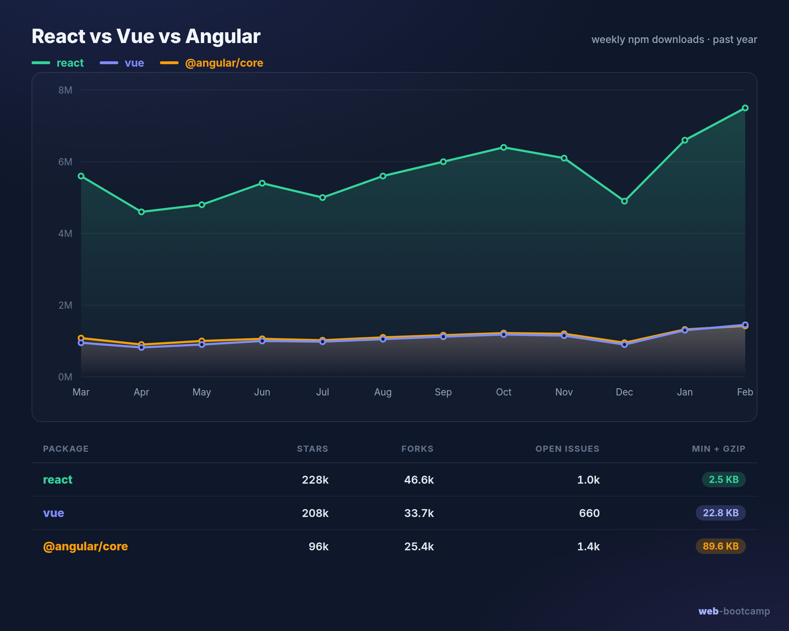

## How to choose
* Which is better for my next web app development project?
* Which framework or library offers the best performance?
* Which is the most suitable for me?
* What is the virtual DOM (and how does Solid's fine-grained reactivity differ)?

**React** is scaffolded with **Vite** today (a fast dev server + build tool); **Angular** ships its own
CLI (`ng`). The old CDN `<script>` tags and `create-react-app` setups are legacy.

### Angular
* Scaffold a project: `npm install -g @angular/cli` then `ng new my-app` (Angular has its own CLI and
  build system, it is not Vite based).
* Templates use bindings `[prop]`, events `(event)`, two-way `[(ngModel)]`, and the built-in control
  flow `@if` / `@for` (the older `*ngIf` / `*ngFor` structural directives still appear in many codebases).
* Modern Angular (v17+) uses **standalone components** and **signals** for reactive state (the older
  NgModule-based setup still exists in older projects).
* Docs - [link](https://angular.dev/)

```ts
import { Component, signal } from '@angular/core';

@Component({
  standalone: true,
  selector: 'app-counter',
  template: `
    <h1>This is how Angular binds data to HTML {{ count() }}</h1>
    <button (click)="addOne()">Add one</button>
  `,
})
export class CounterComponent {
  count = signal(0);
  addOne() {
    this.count.update((n) => n + 1);
  }
}
```

### React 18/19
* Scaffold a project: `npm create vite@latest my-app -- --template react` (or use a framework like
  **Next.js**). `create-react-app` is deprecated and unmaintained.
* Modern React is **function components + hooks** (`useState`, `useEffect`, ...). Class components and
  the in-browser Babel + UMD `<script>` setup are legacy. Note the old class example mutated a plain
  field instead of state, the whole point of `useState` is that changing it re-renders the component.
* Docs - [link](https://react.dev/)

```jsx
import { useState } from 'react';

function Counter() {
  const [count, setCount] = useState(0);

  return (
    <div>
      <h1>This is how React binds data to HTML {count}</h1>
      <button onClick={() => setCount(count + 1)}>Add one</button>
    </div>
  );
}

export default Counter;
```

### CMS
* WordPress - most popular and widely used
* Joomla
* PrestaShop / WooCommerce - good setups for building a shop
* etc.

### Hosted site builders
* Wix
* Squarespace
* Webflow
* etc.

### Other JS frameworks worth knowing
* Svelte / SvelteKit - a compiler, no virtual DOM
* SolidJS - fine-grained reactivity, JSX syntax
* Astro - content-first, ships almost no JS by default
* Vue - covered in the previous lessons
* Meta-frameworks: Next.js (React), Nuxt (Vue), Remix

# React vs Vue vs Angular

