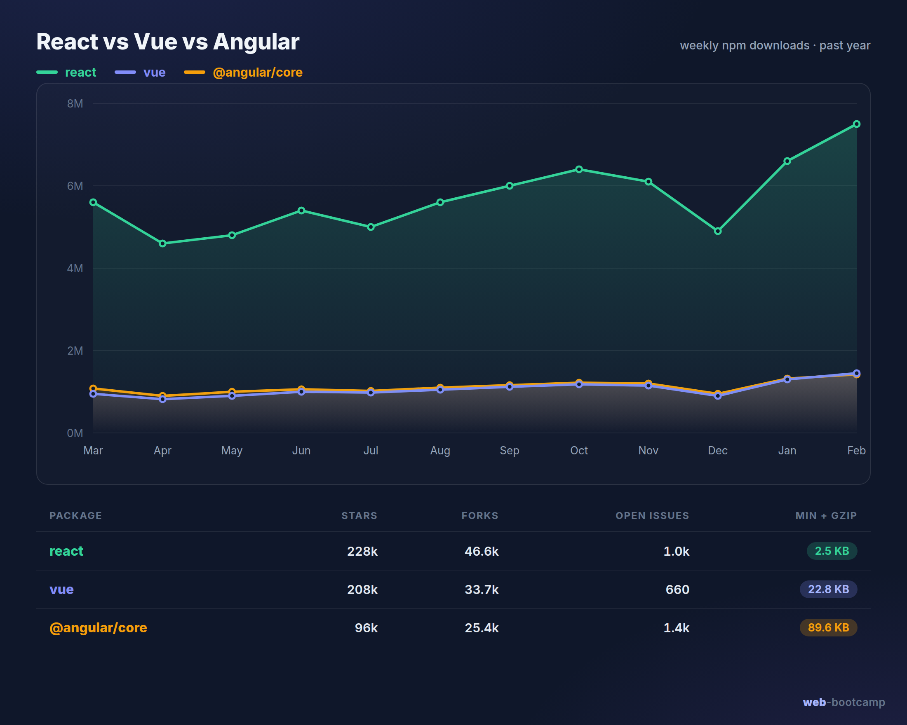

## How to choose
* Which is better for my next web app development project?
* Which framework or library offers the best performance?
* Which is the most suitable for me?
* What is the virtual DOM (and how does Vue/Solid's fine-grained reactivity differ)?

All three frameworks below are scaffolded with **Vite** today (a fast dev server + build tool). The
old CDN `<script>` tags and `create-react-app` setups are legacy.

### Vue 3
* Scaffold a project: `npm create vue@latest` (Vite based).
* Template directives start with `v-`: `v-bind` (shorthand `:`), `v-on` (shorthand `@`), `v-model`.
* Modern Vue uses the **Composition API** with `<script setup>` and reactive `ref()`s (the old
  Options API + global `Vue.component` still works but is not how new code is written).
* Docs & examples - [link](https://vuejs.org/examples/)

```vue
<!-- Counter.vue -->
<script setup>
import { ref } from 'vue';

const heading = ref('This is how Vue binds data to HTML');
const clickCount = ref(0);
const addCount = () => clickCount.value++;
</script>

<template>
  <h1>{{ heading }} {{ clickCount || '' }}</h1>
  <button @click="addCount">Add one</button>
</template>
```

### React 18/19
* Scaffold a project: `npm create vite@latest my-app -- --template react` (or use a framework like
  **Next.js**). `create-react-app` is deprecated and unmaintained.
* Modern React is **function components + hooks** (`useState`, `useEffect`, ...). Class components and
  the in-browser Babel + UMD `<script>` setup are legacy. Note the old class example mutated a plain
  field instead of state, the whole point of `useState` is that changing it re-renders the component.
* Docs - [link](https://react.dev/)

```jsx
import { useState } from 'react';

function Counter() {
  const [count, setCount] = useState(0);

  return (
    <div>
      <h1>This is how React binds data to HTML {count}</h1>
      <button onClick={() => setCount(count + 1)}>Add one</button>
    </div>
  );
}

export default Counter;
```

### CMS
* WordPress - most popular and widely used
* Joomla
* PrestaShop / WooCommerce - good setups for building a shop
* etc.

### Hosted site builders
* Wix
* Squarespace
* Webflow
* etc.

### Other JS frameworks worth knowing
* Svelte / SvelteKit - a compiler, no virtual DOM
* SolidJS - fine-grained reactivity, JSX syntax
* Astro - content-first, ships almost no JS by default
* Angular - covered in the previous lessons
* Meta-frameworks: Next.js (React), Nuxt (Vue), Remix

# React vs Vue vs Angular

